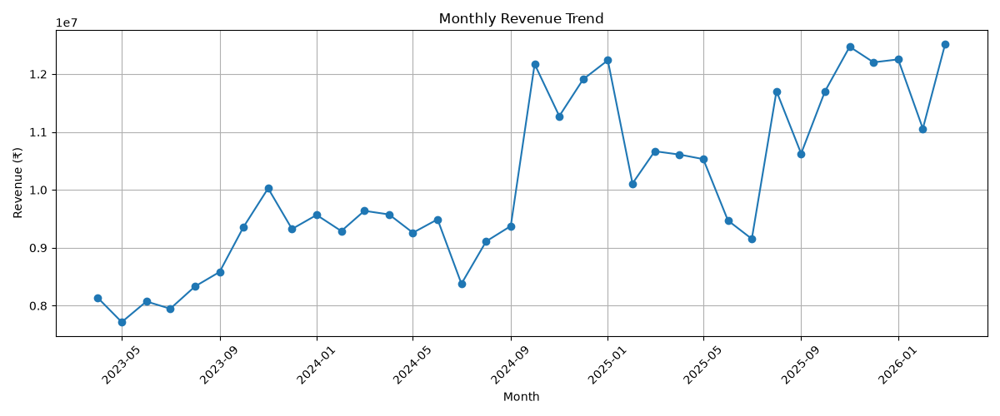
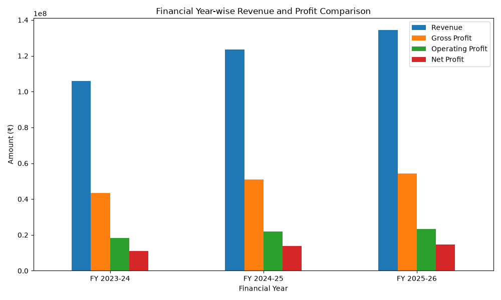
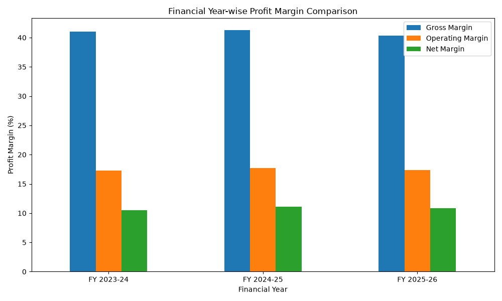
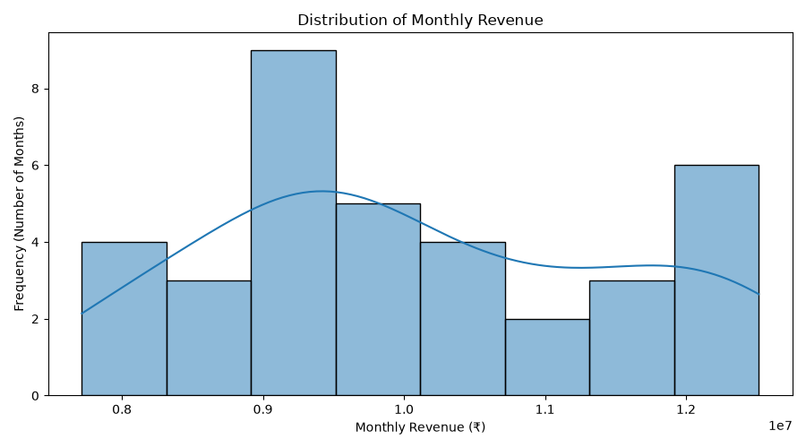
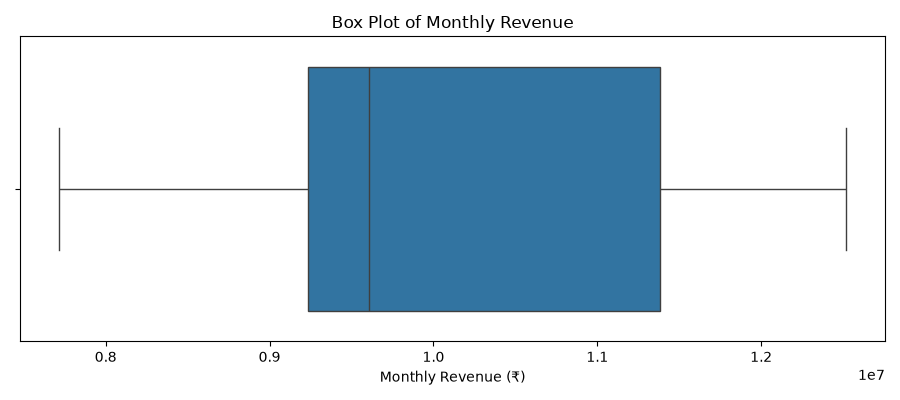
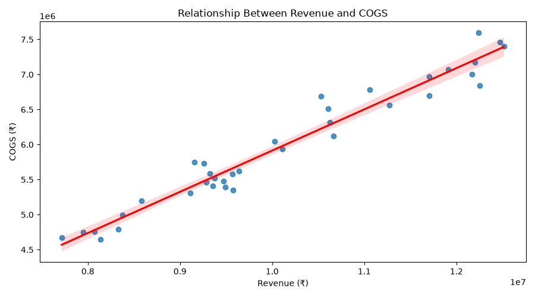

# Corporate Financial Performance & Profitability Analysis Using Python

## Project Overview

An end-to-end corporate financial analysis project using Python to evaluate the financial performance, profitability, cost structure, cash flow, and business trends of a fictional Indian retail and distribution company.

The project applies financial analysis, exploratory data analysis (EDA), statistical hypothesis testing, correlation analysis, regression modelling, and data visualization to convert financial data into meaningful business insights.

## Business Objectives

- Evaluate revenue, expenses, and profitability.
- Analyse gross profit, operating profit, and net profit margins.
- Compare actual financial performance against budgets.
- Examine cash inflows, cash outflows, and net cash flow.
- Identify financial trends and relationships between key variables.
- Apply statistical techniques to evaluate monthly profitability.
- Develop actionable business recommendations.

## Dataset Overview

- **Company:** Fictional Indian retail and distribution company
- **Period:** April 2023 – March 2026
- **Frequency:** Monthly
- **Observations:** 36 months
- **Currency:** Indian Rupees (₹)

### Dataset Files

- [Original Financial Dataset](dataset/financial_performance.csv)
- [Cleaned Financial Dataset](dataset/financial_performance_cleaned.csv)

## Tools & Technologies

- Python
- Pandas
- NumPy
- Matplotlib
- Seaborn
- SciPy
- Scikit-learn
- Visual Studio Code

## Project Methodology

The project was completed through the following phases:

1. **Data Understanding** – Examined the dataset structure, columns, data types, and financial variables.
2. **Data Cleaning & Preparation** – Checked data quality and prepared the dataset for analysis.
3. **Financial KPI Calculations** – Calculated revenue, COGS, gross profit, operating expenses, operating profit, net profit, profitability ratios, and cash flow metrics.
4. **Exploratory Data Analysis (EDA)** – Examined distributions, trends, outliers, and relationships between financial variables.
5. **Financial Performance Analysis** – Evaluated financial performance, budget achievement, yearly growth, and profitability trends.
6. **Statistical Analysis** – Performed confidence interval estimation, hypothesis testing, correlation analysis, and regression analysis.
7. **Data Visualization** – Created charts to communicate financial trends and relationships.
8. **Business Insights & Reporting** – Developed key findings, management recommendations, and a final financial analysis report.

## Key Financial Findings

| Financial Metric | Result |
|---|---:|
| Total Revenue | ₹36.38 Cr |
| Cost of Goods Sold (COGS) | ₹21.52 Cr |
| Gross Profit | ₹14.86 Cr |
| Operating Expenses | ₹8.52 Cr |
| Operating Profit | ₹6.35 Cr |
| Net Profit | ₹3.95 Cr |
| Gross Profit Margin | 40.85% |
| Operating Profit Margin | 17.44% |
| Net Profit Margin | 10.85% |
| Operating Expense Ratio | 23.41% |
| Net Cash Flow | ₹6.68 Cr |
| Revenue Budget Achievement | 103.22% |

## Statistical Analysis

### Confidence Interval & Hypothesis Testing

- Calculated the 95% confidence interval for average monthly net profit: **₹10,08,232.75 – ₹11,84,203.51**.
- Conducted a one-sample, one-tailed t-test against a monthly net profit benchmark of ₹10 lakh.
- Test statistic: **2.2201**
- P-value: **0.0165**
- The null hypothesis was rejected at the 5% significance level.

### Correlation Analysis

Examined relationships between major financial variables:

- Revenue and COGS: 0.98
- Revenue and Net Profit: 0.74
- COGS and Net Profit: 0.60
- Revenue and Operating Expenses: 0.93

### Regression Analysis

Developed a linear regression model to examine the relationship between revenue and COGS.

- R-squared: **0.9539**
- Regression coefficient for revenue: **0.5885**

The model indicates a strong positive linear relationship between revenue and COGS. This is an association, not evidence of causation.

## Data Visualizations

### Monthly Revenue Trend


### Financial Year-wise Revenue and Profit Comparison


### Financial Year-wise Profit Margin Comparison


### Distribution of Monthly Revenue


### Box Plot of Monthly Revenue


### Relationship Between Revenue and COGS


## Key Business Insights

- Revenue increased across the three financial years, although the year-on-year growth rate slowed in FY 2025–26.
- The company maintained a gross profit margin of 40.85% and a net profit margin of 10.85%.
- Revenue and COGS have a strong positive relationship, indicating that higher sales are associated with higher cost of goods sold.
- Net cash flow was higher than net profit, highlighting the importance of analysing cash flow alongside accounting profitability.
- Revenue exceeded the overall budget, achieving 103.22% of the planned amount.
- The statistical test provided evidence that average monthly net profit was above the ₹10 lakh benchmark under the assumptions of the test.

## Management Recommendations

- Monitor COGS closely to protect gross profit margins.
- Review operating expenses regularly to improve operating efficiency.
- Investigate the slowdown in year-on-year revenue growth.
- Strengthen cash flow monitoring and working capital management.
- Track actual financial performance against budgets regularly.
- Monitor profitability trends rather than relying only on revenue growth.

## Project Limitations

- The dataset is fictional and created for analytical and portfolio demonstration purposes.
- The analysis covers 36 monthly observations.
- Statistical testing assumes independent observations; monthly financial data may contain time-related patterns that affect this assumption.
- Correlation and regression results identify relationships and should not be interpreted as proof of causation.
- The operating expense budget field has a data consistency limitation and was not used for a direct actual-versus-budget operating expense comparison.

## Final Report

The complete financial analysis, visualizations, statistical findings, business insights, and recommendations are available in the final report:

[**View Financial Analysis Report (PDF)**](reports/Financial_Analysis_Report.pdf)

## Repository Structure

```text
Corporate-Financial-Analysis/
│
├── dataset/
│   ├── README.md
│   ├── financial_performance.csv
│   └── financial_performance_cleaned.csv
│
├── notebooks/
│   └── README.md
│
├── scripts/
│   ├── README.md
│   └── financial_analysis.py
│
├── visualizations/
│   ├── README.md
│   ├── revenue_trend.png
│   ├── revenue_distribution.png
│   ├── revenue_boxplot.png
│   ├── profit_margin_comparison.png
│   ├── yearly_revenue_profit_comparison.png
│   └── revenue_cogs_regression.png
│
├── reports/
│   ├── README.md
│   └── Financial_Analysis_Report.pdf
│
└── README.md
```

## How to Run the Project

1. Clone or download this repository.
2. Install the required Python libraries.
3. Open the project folder in Visual Studio Code.
4. Run the analysis script:

```bash
python scripts/financial_analysis.py
```

See the project files for the datasets, analysis script, visualizations, and final report.

---

## Author

**Pravash Paul**  
Microsoft Certified Power BI Data Analyst (PL-300)

**Project:** Corporate Financial Performance & Profitability Analysis  
**Domain:** Accounting, Finance & Data Analytics  
**Language:** Python
